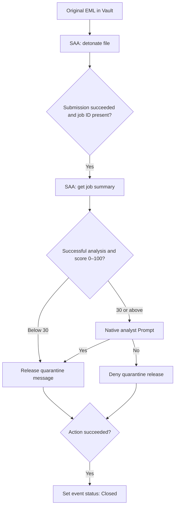

# Native SAA quarantine example

[Back to README](../../README.md)

An inactive SOAR playbook template that analyzes each imported email with Splunk Attack Analyzer (SAA) and then releases or denies it using the MS Defender Quarantine Manager actions. It consists of 13 native Visual Playbook Editor (VPE) blocks, with no custom code and no notification integration.

## Flow



- Score below 30: release. Score 30 or above, including exactly 30: the analyst decides. **Yes** releases and **No** denies.
- A missing or invalid score, a failed action, or an unanswered or failed Prompt never releases, denies or closes the event. The event stays open for investigation. There is no automatic denial based on the score.
- The event is closed only after a successful Release or Deny.
- `get_summary` waits up to 30 minutes for SAA, and the Prompt expires after 24 hours. Neither timeout counts as approval.
- Do not automatically rerun a failed quarantine action, because its outcome in Azure may be uncertain.

## Input

The playbook needs the app's **combined** layout: one event per email, with a single email artifact that triggers automation. It does not work with the Ready/Request layout or with ES findings. The event must contain only that one artifact with a `cef.vaultId`, so do not add email artifacts manually or replay events.

| Input | Data path |
|---|---|
| Original EML | `artifact:*.cef.vaultId` |
| Quarantine identity | `container:data.quarantine_identity` |
| Sender / recipient | `artifact:*.cef.senderAddress` / `artifact:*.cef.recipientAddress` |
| Subject | `container:name` |
| SAA job | `submit_email:action_result.data.*.JobID` |
| Score / report link | `get_summary:action_result.summary.Score` / `get_summary:action_result.summary.AppURL` |

## Import and configure

Package the native JSON/Python pair at the archive root. The archive contains no app or runbook.

```sh
cd examples/MS_Quarantine_SAA_Example
tar -czf MS_Quarantine_SAA_Example.tgz MS_Quarantine_SAA_Example.json MS_Quarantine_SAA_Example.py
```

Import it through **Playbooks → Import Playbook** into a writable repository. It arrives **inactive and in draft mode**. Keep it inactive while you configure it:

1. In `submit_email` and `get_summary`, replace `configure_saa_asset` with your **Splunk Attack Analyzer Connector for Splunk SOAR** asset.
2. In `release_email` and `deny_email`, replace `configure_quarantine_asset` with your **MS Defender Quarantine Manager** asset (app UUID `2e21b2c5-a6a6-4fb4-8df7-9dd1135ab08e`). Assets of the older MS Quarantine Manager app do not work.
3. In `review_email`, replace the user `configure_approver` with a local user or a role. No email address or notification connector is needed.
4. Set the playbook label to the ingesting asset's container label. The template uses `events` and the trigger `artifact_created`.
5. To change the threshold, edit **both** comparisons in `score_policy` (`< 30` and `>= 30`) and keep the success and valid-score checks.
6. Open every block in the VPE, save and reopen. Then run the tests below with controlled messages before activating.

The threshold of 30 is an example, not a recommended security policy.

## Verification status

| Check | Status |
|---|---|
| Native server-side validation of the JSON/Python pair | Passed (SOAR 8.8.0.282, SAA connector 2.2.6) |
| Visual Playbook Editor | Passed on a locally mapped copy: all 13 blocks opened without datapath warnings; timeout, thresholds, Prompt and status settings were edited, saved, reopened and restored |
| Runtime execution (SAA, Azure, Exchange actions) | **Not performed** |
| End-to-end compatibility with the app/runbook | **Not verified** ([compatibility](../../docs/compatibility.md)) |

The editor check used a pre-release source build (`1832021`), not a live test of the 1.0.0 packages. The repository copy replaces local assets and approvers with the placeholders above.

Before activation, test at least the following: scores 0, 29, 30 and 100; a missing or invalid score; submission and analysis failures; Prompt Yes, No, timeout and failure; failed Release/Deny; and successful Release/Deny followed by closure.
