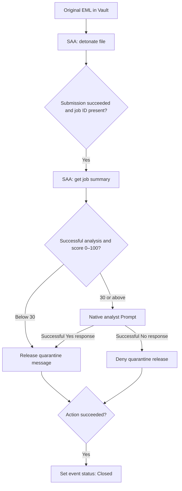

# Native SAA quarantine example

[Documentation index](../../docs/README.md) · [App/runbook compatibility](../../docs/compatibility.md)

An inactive, single-email SOAR automation playbook using Splunk Attack Analyzer (SAA) and the existing MS Quarantine actions. It has 13 native blocks, no custom code, no other analyzer and no notification integration.

## Flow



Every omitted/error branch leaves the event status unchanged. There is no automatic score-based denial. A missing score, failed action, unanswered/failed Prompt or unconfirmed quarantine operation does not authorize release or closure. Native action results retain the error details. A failed Azure action can have an uncertain remote outcome; do not automatically rerun it.

`get_summary` waits up to 30 minutes for SAA completion using the connector's native `timeout` parameter. The Prompt has a 24-hour response window. Neither timeout grants approval.

## Input and assets

Use the app's **combined** SOAR layout: one fresh event per quarantined email and one final email artifact that triggers automation. This example is not an ES finding/input-spec playbook and does not consume the retired Ready/Request artifact layout. Exactly one artifact in the event may contain `cef.vaultId`: the original EML. The wildcard datapath otherwise selects every Vault-bearing artifact; this example does not aggregate multiple emails or attachments. Do not manually replay an event or attach multiple email artifacts to it.

| Input | Datapath |
|---|---|
| Original EML, not an extracted attachment | `artifact:*.cef.vaultId` |
| Quarantine identity for Release/Deny | `container:data.quarantine_identity` |
| Sender / recipient | `artifact:*.cef.senderAddress` / `artifact:*.cef.recipientAddress` |
| Subject | `container:name` |
| SAA job | `submit_email:action_result.data.*.JobID` |
| Score / report link | `get_summary:action_result.summary.Score` / `get_summary:action_result.summary.AppURL` |

The producer must finish Vault uploads before publishing the final artifact. See the [ingestion contract](../../docs/ingestion.md#updating-an-existing-playbook-consumer).

## Import and configure

The JSON and Python files are a native export pair. Package both files at the archive root; no app or runbook is included:

```sh
cd examples/MS_Quarantine_SAA_Example
tar -czf MS_Quarantine_SAA_Example.tgz MS_Quarantine_SAA_Example.json MS_Quarantine_SAA_Example.py
```

Import this archive through SOAR **Playbooks → Import Playbook** into a writable repository. It imports **inactive and in draft mode**. Keep it inactive while editing and validating these settings:

1. In `submit_email` and `get_summary`, replace `configure_saa_asset` with the intended **Splunk Attack Analyzer Connector for Splunk SOAR** asset.
2. In `release_email` and `deny_email`, replace `configure_quarantine_asset` with the asset of **MS Quarantine for Splunk SOAR**, app UUID `2e21b2c5-a6a6-4fb4-8df7-9dd1135ab08e`. The earlier MS Quarantine Manager app identity is not interchangeable.
3. In `review_email`, replace user `configure_approver` with a valid local user, or select a native role recipient. No email address or notification connector is required.
4. Set the playbook's label to the label used by the ingesting asset; the template uses `events`. Its automation trigger is `artifact_created`.
5. To change the example threshold, edit **both** comparisons in `score_policy`: the first branch is `< 30`, the second `>= 30`. Keep the success and valid-score checks. Exactly 30 currently requires an analyst decision.
6. Open every block in the Visual Playbook Editor, save and reopen the playbook. Validate with controlled messages and approved actions before enabling automation. The final Close block is reachable only through successful Release/Deny branches; do not bypass those checks.

The example threshold is a workflow demonstration, not a universal security policy. Asset mapping and playbook activation are separate operator choices.

## Verification scope

Source contract: app/runbook `3.7.4` labels at main commit `1832021e6a52af9f95e7db5e94b331c7957e5b04`; these are unreleased source changes, not an assigned Version 4 release. See the [source-qualified compatibility matrix](../../docs/compatibility.md).

A locally mapped copy was generated using the installed **SOAR 8.8.0.282** native VPE generator and imported with **SAA connector 2.2.6** and the new MS Quarantine app identity. The quarantine Release/Deny action contracts were compared with current main. The native server validator accepted the generated Python/graph pair. In the actual Visual Playbook Editor, all 13 block panels opened without invalid-datapath warnings or page errors. Action timeout, both score thresholds, Prompt deadline and event-status settings were edited, saved and reopened, then restored to the documented values. The final saved copy remained inactive and retained modern VPE format. Its executable Python, graph connections, joins and block configuration matched the reviewed workflow; the UI added only generated comments. Existing playbooks and assets were unchanged.

The distributed copy replaces local asset and approver bindings with the placeholders above. It is a template requiring mapping, not a ready-to-run deployment. No SAA, Azure or Exchange action was executed. Native runtime behavior and end-to-end app/runbook compatibility remain unverified. The completed UI editing/save/reopen check proves editor usability, not action execution or backend compatibility.

Before activation, verify at least: scores 0, 29, 30 and 100; missing/invalid score; submission/analysis failure; Yes, No, timeout and failed Prompt; failed/unconfirmed Release/Deny; successful Release/Deny followed by closure. Failures must leave the event available for investigation.
